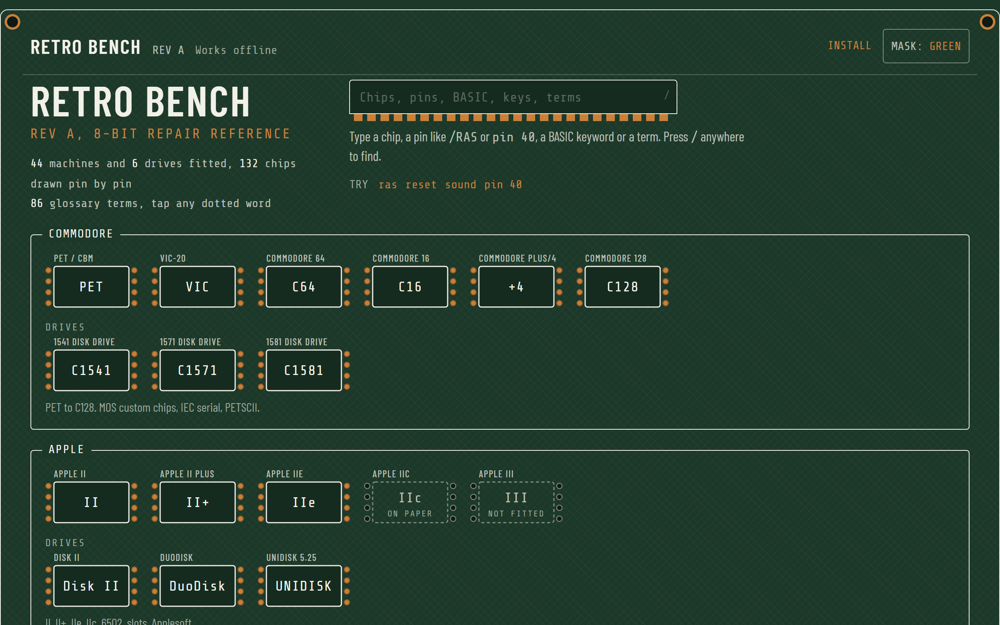
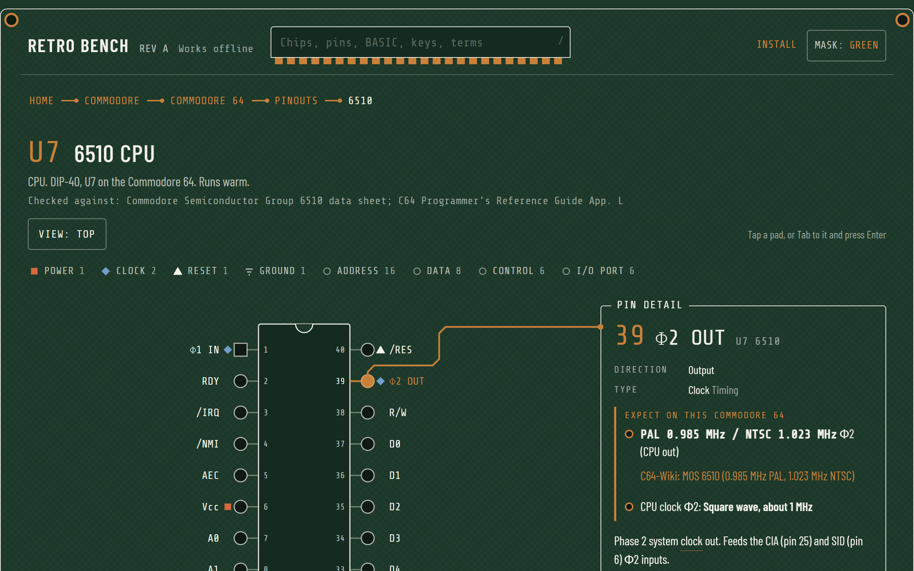
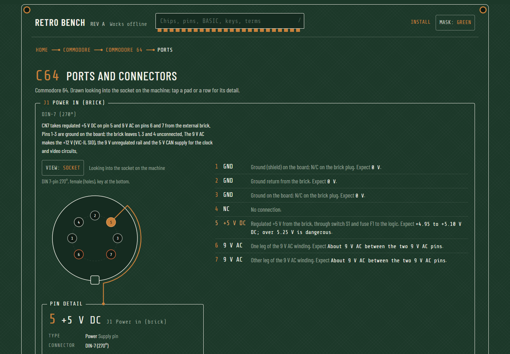
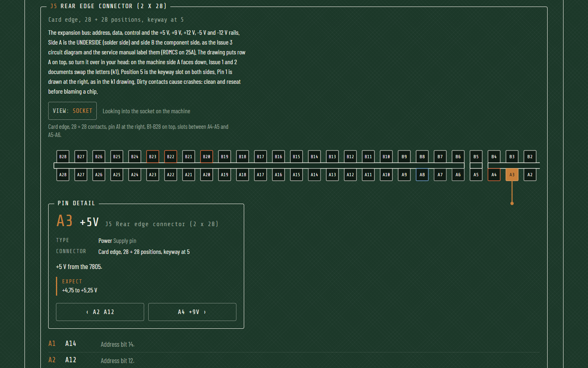
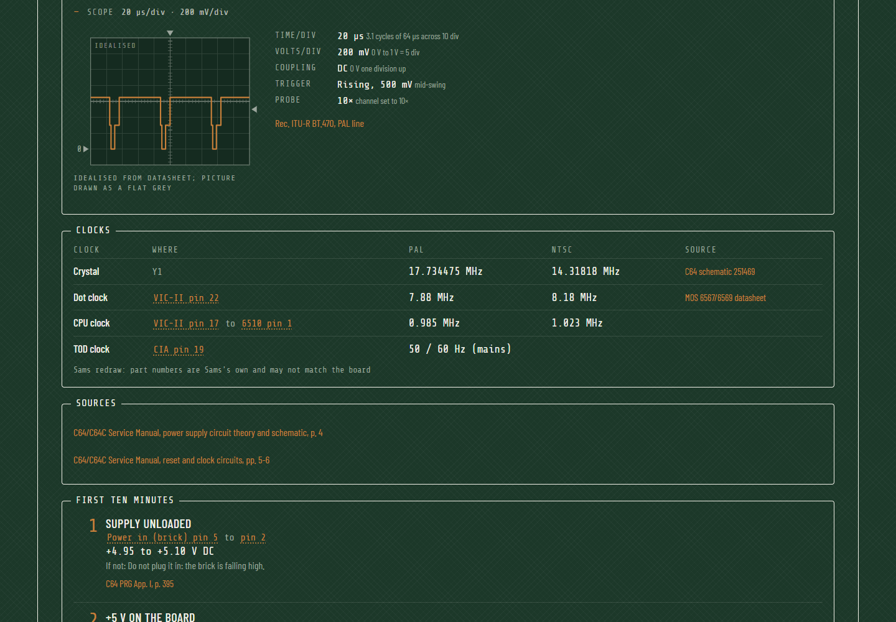
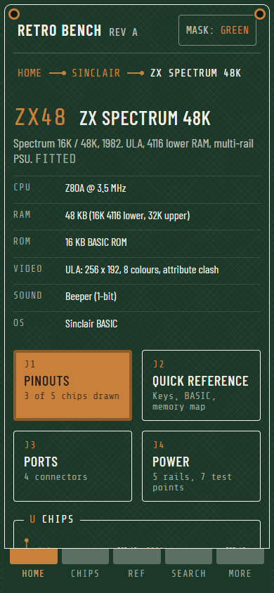
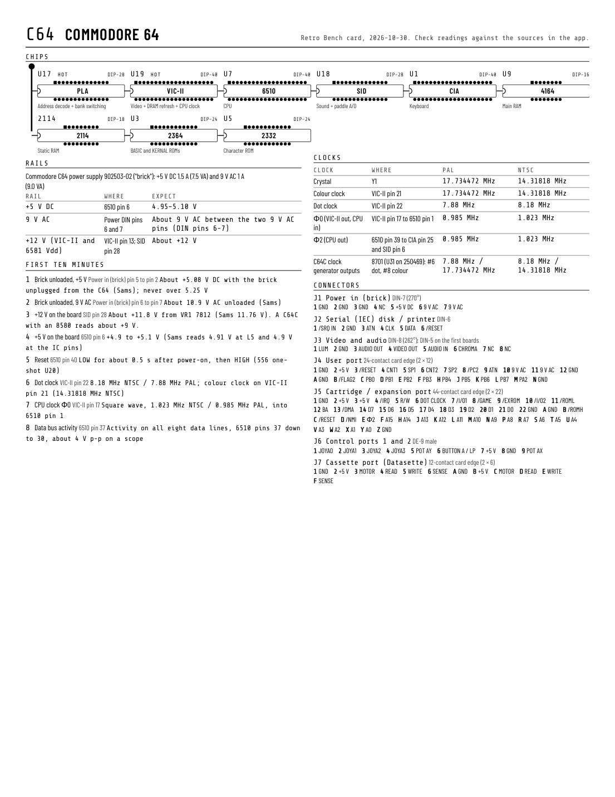

# Retro Bench

**Offline pinouts, test points, connectors and quick reference for 8-bit computer repair, built to sit on the bench next to the board.**

Open it: **<https://paulczy.com/retro-bench/>**. Add it to your home screen and it works with no network.

[](https://paulczy.com/retro-bench/)

## Why

Repairing a Commodore 64 or a BBC Micro means a datasheet in one tab, a service manual PDF in another, a forum post about the power brick in a third, and a meter in your hand. Retro Bench puts the facts a tech reaches for most into one place, sized for an iPad or iPhone propped on the bench: which pin is which, what it should read, where the clock comes from, what fails first, and which part replaces it. Every table links to the document it was checked against.

Counted on 30 October 2026: **62 machines across 15 makers** (50 with full data, 6 of them disk drives), **158 chips, 132 drawn pin by pin**, **472 connectors**, **471 test points**, **166 idealised scope traces**, **328 clock rows**, **336 schematic links**, **141 replacement parts** and **86 glossary terms**. The home page shows the live count.

## What it does

### Chips, pin by pin

Every chip is a DIP footprint seen from above. Tap a pad and a copper trace runs to the pin detail: direction, type, what a working pin reads, and on this machine what frequency or level to expect. Filters pick out power, clock, reset, ground, address, data and control pins. `VIEW: TOP / BOTTOM` flips the chip for probing from the solder side. Pins reconstructed from incomplete sources carry a `CHECK` mark; every chip names the datasheet it was checked against.



### Ports and power supplies

Every external port and internal power header is drawn to its real geometry: DIN and mini-DIN with the key at the bottom, D-sub, card edge with its key slots, RCA, barrel, TRS. `VIEW: SOCKET / PLUG` mirrors the drawing between looking into the machine and looking at the cable. The power page opens with the supply block: ratings, what each pin should read, and known failures.





### Test points, scope traces and the first ten minutes

Test points carry an idealised waveform drawn from the sourced frequency, levels and shape, on a 10 by 8 graticule. The scope settings beside it (time/div, volts/div, coupling, trigger) are derived from the sourced numbers, never typed in. **No trace is a real capture**; each one is labelled "idealised from datasheet" or "idealised from capture". Below that, every machine gets a clock table (crystal, every derived clock, PAL and NTSC, the pin it appears on) and a **first ten minutes** checklist: ordered checks with expected values, each linked to the pad to probe.



### The rest of the bench

- **Replacement parts** per chip: pin-compatible equivalents, modern drop-ins and adapters, with the differences that bite.
- **Boards and schematics**: links to board drawings per board revision, with the hosting archive named.
- **Video signals** (`#/video`): composite levels, NTSC and PAL line and field timing, RGBI, analogue RGB, luma/chroma, RF channels, drawn as one PAL line and tabled with a source on every row.
- **Quick reference** per machine: keys and quirks, BASIC essentials, memory map.
- **Glossary** with tap-to-explain: any dotted term anywhere in the app opens its definition in place.
- **Search** (`/` or Ctrl+K): a chip, a pin like `/RAS` or `pin 40`, a BASIC keyword, a term.
- **Print card**: one Letter page per machine in black on white, with footprints, rails, first ten minutes, clocks and every connector's pins.
- **Bench notes** on every machine and chip page, kept in the browser on your device only, with export and import as a text file. No account, no sync.
- **Three solder masks**: green, black, and light (bare FR-4) for bright benches.

<p>


</p>

## Machines

Status, 30 October 2026. **Full** machines have pinouts, ports, power and test points, quick reference and a fault table. **Sheet** machines have the facts and chip lists from the printed cheat sheets. **Planned** are placeholders.

| Maker | Full | Sheet | Planned |
|---|---|---|---|
| Commodore | PET/CBM, VIC-20, 64, 16, Plus/4, 128; drives 1541, 1571, 1581 | | |
| Apple | II, II Plus, IIe; drives Disk II, DuoDisk, UniDisk 5.25 | IIc | III |
| Atari | 400, 800, 600XL, 800XL, 130XE | | |
| Coleco | ColecoVision, ADAM | | |
| Sinclair | ZX81, ZX Spectrum 48K | ZX80, Spectrum 128, +2, +3 | |
| Timex Sinclair | TS1000, TS2068 | TS1500 | |
| Texas Instruments | TI-99/4A | TI-99/4 | |
| Tandy / TRS-80 | Color Computer 1, 2, 3; MC-10; TRS-80 Model I, III, 4 | | |
| Heathkit | HERO 1, HERO Jr | | HERO 2000 |
| IBM | PC 5150, XT 5160 | PCjr 4860, Portable 5155 | Convertible 5140 |
| Amstrad | CPC 464, 664, 6128 | | |
| Acorn | BBC Micro Model B, BBC Master 128, Electron | | |
| Dragon Data | Dragon 32, Dragon 64 | | |
| MSX | MSX1 (generic), MSX2 (generic) | | |
| Oric | Oric-1, Atmos | | |

Computers and their drives only; no consoles. What comes next is in [docs/roadmap.md](docs/roadmap.md).

## Install and use offline

Retro Bench is a progressive web app. The first visit caches the whole app (shell, every data file, CSS, fonts, icons); after that it runs with no network. The strip at the top reads `Works offline` when the cache has landed.

- **iPhone and iPad**: open the site in Safari, tap Share, then **Add to Home Screen**. It launches full screen like a native app.
- **Desktop Chrome or Edge**: tap the copper **Install** link in the strip, or the browser's install icon in the address bar.
- **Android**: open **More** and tap **Install**, or use Chrome's menu, Add to Home screen.
- **Any browser**: just bookmark it. The cache still works.

When a new version is deployed, an open page shows `Updated, reload`. Nothing phones home; bench notes never leave the device.

## Run it locally

```bash
git clone https://github.com/paulczy/retro-bench.git
cd retro-bench
npm install
npm run build        # Tailwind (src/input.css → dist/app.css), then the service-worker precache list
```

Then open `index.html`, or serve the folder (`python -m http.server 8000` and visit `http://localhost:8000/`). Hash routing needs no server and every URL is relative, so it also runs from `file://` or under a sub-path. `npm run watch` rebuilds the CSS on change.

Plain HTML, vanilla JavaScript and Tailwind CSS v4. No framework, no bundler, no CDN. The data files load as `<script>` tags.

## Build and deploy

`npm run build` runs Tailwind and then `scripts/build-sw-manifest.mjs`, which reads every local asset in `index.html`, the manifest and `fonts/`, and writes that list plus a content hash into `sw.js`. A new hash means a new cache; the old one is dropped when the new worker activates.

[`.github/workflows/pages.yml`](.github/workflows/pages.yml) builds and publishes to GitHub Pages on every push to `main`. One-time setup on a fork: Settings, Pages, Source: GitHub Actions. The app runs from any static host; nothing is server-side.

## Data and sources

All content lives in `src/data/`, one file per maker, in the shape described in [docs/data-schema.md](docs/data-schema.md). The rules:

- **Every table links to its source.** Chip tables name the datasheet or service manual they were checked against. Connectors, rails, test points, clocks, first-ten steps and replacement rows each carry a link a human can open. The **Sources and credits** page in the app lists every cited document by host.
- **Nothing is invented.** A fact that could not be checked is left out or marked `verify: true`, which the app shows as `CHECK`. Where two sources disagree, the primary one wins and the other is recorded as a conflict on the pin.
- **Sams Computerfacts is secondary.** Sams folders supply measured voltages and waveform photos, but Sams redrew the schematics with its own part numbers. Every block that cites Sams says so.
- **Scope traces are idealised** from sourced numbers and labelled as such. They are never presented as real captures.

`node scripts/validate-data.mjs` checks every data file: shapes, cross-references, pin counts against the package, unknown chips and machines, and source conflicts. Run it after every edit; fix every FAIL. The per-maker verification logs are in [docs/verification/](docs/verification/).

### Contributing a correction

Found a wrong pin, a missing port, a better source? [Open an issue](https://github.com/paulczy/retro-bench/issues) with the machine, the chip or connector, the pin, and a link to the document that shows the right value. Pull requests are welcome too: edit the maker's file in `src/data/`, link the source, run the validator, and say in the PR what you checked it against.

## Credits

Retro Bench is a reading of other people's work: the chip makers' datasheets, the manufacturers' manuals and the archives that keep them online. The app's credits page thanks them in full; in short: zimmers.net (Bo Zimmerman), Bitsavers (Al Kossow), the Internet Archive, minuszerodegrees.net (modem7), the Apple II Documentation Project, the Color Computer Archive, World of Spectrum, timexsinclair.com, AtariArchives.org and AtariAge, WHTech, C64-Wiki, Ray Carlsen, Howard W. Sams & Co., and Wikimedia Commons for connector standards.

Pin tables started from the [retro-computer-cheetsheets](https://github.com/paulczy/retro-computer-cheetsheets) sheets and were then verified against the published manuals. Type is Barlow Condensed and Share Tech Mono (SIL Open Font License), self-hosted.

Check against a datasheet before powering anything up. This is a reference, not a guarantee.

## Licence

Code is MIT ([LICENSE](LICENSE)). The reference data in `src/data/` is CC BY 4.0 ([LICENSE-DATA](LICENSE-DATA)). Product names and trademarks belong to their owners.
